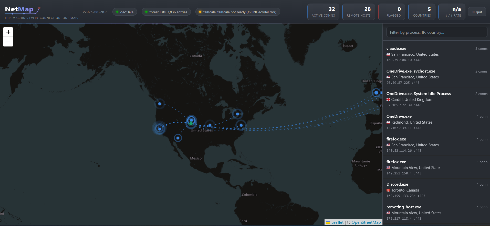

# NetMap

**A live world map of your computer's connections, and of every device on your network, in your browser.**


-brightgreen)
[](https://buymeacoffee.com/huskerminion)

NetMap plots network connections on a live, dark-themed world map with animated
arcs from home to each destination. It has two views:

- **This machine**: every connection of the computer NetMap runs on, per process,
  including connections made inside Docker containers on Linux.
- **Network**: every connection of every device on your network, read from an
  OpenWrt router. Devices get names, subnets get colours, and you can filter by subnet.

Every connection is **logged** with its time, device, direction and approximate location *at that
moment*, and **classified**: public blocklists (botnet C2, hijacked networks,
attackers, Tor…) plus **your own rules**, written in the web UI. A **timeline**
under the map replays any moment in the past.

Python standard library only. One SQLite database. No build step.



## Features

- Live map with pulsing markers and arcs; inbound connections animate towards home
- **Network tab** from an OpenWrt router: outgoing, incoming (port forwards),
  between-subnet and router traffic, with device names (DHCP) and domain names (dnsmasq)
- **Subnets** with names and colours, managed in the app; filter map, list and history by subnet
- **Connection log** in SQLite with a size cap (default 4 GB, oldest first), so months of history fit
- **History tab** per view, searchable, paged, *flagged only* filter; click a row to see the map at that moment
- **Timeline**: scrub or replay the last hour, day, week, month or year
- **Threat classification**: Feodo Tracker, Spamhaus DROP, FireHOL level 1,
  blocklist.de, CINS Army and Tor exits, each with a category and severity
- **Behaviour rules** in Python syntax, edited and tested in the UI, run in a safe
  interpreter (see [docs/RULES.md](docs/RULES.md)); e.g. `subnet == "IoT" and new_country`
- **Verdicts**: trust, mark suspicious or ignore an IP, domain or device
- **Offline geolocation** (DB-IP Lite, refreshed monthly, ~720 MB on disk). Addresses it doesn't know are
  looked up once on ip-api.com and stored
- **Admin login** (scrypt-hashed password, CSRF protection, lockout); works behind a reverse proxy
- Tailscale peers on the This machine view

## Quick start (your own PC)

```bash
python netmap.py --no-auth
```

Your browser opens `http://localhost:8339`. `--no-auth` skips the login and is only
allowed while NetMap listens on 127.0.0.1. On Windows, double-click `NetMap.bat`,
which does this without a console window.

Without `--no-auth` the first start prints a **setup code** in the console. Enter it
in the page to choose the admin password.

## Server, Docker, TrueNAS

```bash
docker compose up -d --build
docker logs netmap            # shows the setup code on first start
```

See **[docs/DOCKER.md](docs/DOCKER.md)** for TrueNAS, reverse proxies and every
`NETMAP_*` variable.

## Network tab: your router

Setting up the router takes about ten minutes, once: install `conntrack`, copy one small script, and add
NetMap's key, which can only run that script. Follow **[docs/ROUTER.md](docs/ROUTER.md)**
(written for OpenWrt 25.x).

## Requirements

- Python 3.8+. Nothing to install.
- Optional `psutil` for the up/down rate tiles.
- For the Network tab: an OpenWrt router and an `ssh` client (included in the Docker image).

Sockets of *other* users' processes are only attributable when running elevated
(or in Docker with the privileges in `docker-compose.yml`). Your own always resolve.

## Options

`python netmap.py --help` lists them all. Each has an environment variable:

| Flag | Env | Default |
|---|---|---|
| `--port N` | `NETMAP_PORT` | 8339 |
| `--bind ADDR` | `NETMAP_BIND` | 127.0.0.1 |
| `--allow-host NAMES` | `NETMAP_ALLOWED_HOSTS` | localhost |
| `--data-dir DIR` | `NETMAP_DATA_DIR` | next to `netmap.py` |
| `--max-db-mb N` | `NETMAP_MAX_DB_MB` | 4096 |
| `--home LAT,LON` | `NETMAP_HOME` | located automatically |
| `--no-auth` | `NETMAP_AUTH=off` | login on |
| `--no-geo-download` | `NETMAP_GEO_DOWNLOAD=off` | download offline DB |
| `--no-geo-online` | `NETMAP_GEO_ONLINE=off` | use ip-api.com fallback |
| `--reset-password` | | clears the admin password |

## Privacy

Everything is stored locally in the data folder. What leaves the machine:

- **Remote IPs the offline database doesn't know** go to [ip-api.com](https://ip-api.com)
  (plain HTTP, the free tier has no HTTPS), once per IP. Turn it off with `NETMAP_GEO_ONLINE=off`.
- Your public IP is sent to ip-api.com once to place "home" on the map. Skip it with `--home`.
- Downloads: the DB-IP database (monthly), the blocklists (every 6 h), map tiles and Leaflet.

NetMap logs every device's destinations, which is sensitive. Keep the login on,
don't expose the port to the internet, and keep `NETMAP_ALLOWED_HOSTS` exact.

## Documentation

| | |
|---|---|
| [docs/ROUTER.md](docs/ROUTER.md) | OpenWrt setup and troubleshooting |
| [docs/RULES.md](docs/RULES.md) | rule language, fields, examples |
| [docs/DOCKER.md](docs/DOCKER.md) | Docker, TrueNAS, reverse proxy, environment variables |
| [docs/ARCHITECTURE.md](docs/ARCHITECTURE.md) | how it works, files, debugging, tests, common changes |

Tests: `python -m unittest discover -s tests -t .`

## Credits

Map: [Leaflet](https://leafletjs.com/), tiles © [Esri](https://www.esri.com) (World Dark Gray),
fallback © [OpenStreetMap](https://www.openstreetmap.org/copyright) contributors. IP geolocation by
[DB-IP](https://db-ip.com) (CC BY 4.0) and [ip-api.com](https://ip-api.com).
Blocklists by [abuse.ch](https://abuse.ch), [Spamhaus](https://www.spamhaus.org),
[FireHOL](https://iplists.firehol.org), [blocklist.de](https://www.blocklist.de),
[CINS Army](https://cinsscore.com) and the [Tor Project](https://www.torproject.org).

## License

[MIT](LICENSE) © 2026 huskerminion
